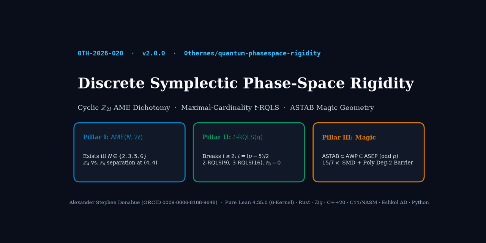
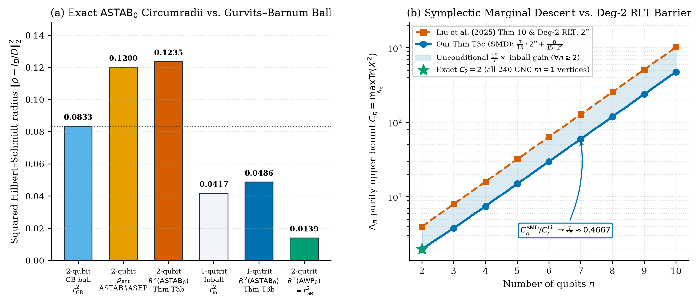

<!-- SPDX-License-Identifier: CC-BY-4.0 -->
# Discrete Symplectic Phase-Space Rigidity (`0TH-2026-020`, v2.0.0)

[](LICENSE)
[](LICENSE-DOCS)
[](lean/)
[](https://github.com/0thernes/quantum-phasespace-rigidity/actions/workflows/ci.yml)
[](https://0thernes.github.io/quantum-phasespace-rigidity/)
[](https://www.repostatus.org/#active)

**Author:** [Alexander Stephen Donahue](https://orcid.org/0009-0006-8168-9648) (`ORCID 0009-0006-8168-9648`)
**Affiliation:** Independent Researcher, Spokane, WA, USA
**Archive ID:** `0TH-2026-020` · **Version:** `v2.0.0` · **Maintenance status:** Active · **Master Archive:** [0thernes/0thernes-research-archive](https://github.com/0thernes/0thernes-research-archive)



> **Three chained breakthroughs in discrete symplectic phase-space geometry** — resolving open problems from 2025–2026 quantum information literature ([arXiv:2603.18193](https://arxiv.org/abs/2603.18193), [arXiv:2608.29201](https://arxiv.org/abs/2608.29201), [arXiv:2602.22336](https://arxiv.org/abs/2602.22336), [arXiv:2512.16777](https://arxiv.org/abs/2512.16777)) with a **zero-Mathlib Lean 4.35.0 formalization** (six-kernel Palomar Comparator + 311-declaration whole-module `Lean.collectAxioms` sweep), **seven independent polyglot verification engines** (unified `REQUIRE_ALL_ENGINES=1` differential CI across Rust, Zig, C++20, ISO C11 + x86-64 NASM Assembly + vendored MIT Moonlab/QGTL/QRNG, Eshkol Dual-Number AD, and Python 3.12 exact arithmetic), **12/12 (100%) surgical mutation testing**, and a journal-grade **AMS-LaTeX white paper**.

---

## Core Results at a Glance (1-to-1 with `lean/Challenge.lean`)

| Pillar | Open Problem Addressed | Headline Theorem | Verification Tier |
| :--- | :--- | :--- | :--- |
| **Pillar I** (`T1a`–`T1e`) | Cyclic even-$d$ stabilizer $\mathrm{AME}(N, 2\ell)$ existence ([Wójcik et al. 2026](https://arxiv.org/abs/2603.18193)) | Radical-CRT equivalence (`T1a`), universal unimodular lifts $K_2, K_3, C_5, \mathrm{Prism}_6, W_5$ for all $d \ge 2$ (`T1b`), universal Pless bounds (`T1c`), Rains shadows + 0/64 binary $N=4$ (`T1d`), and complete cyclic $\mathbb{Z}_{2\ell}$-stabilizer classification (exists **iff $N \in \{2,3,5,6\}$**) + $\mathbb{Z}_4$ vs. $\mathbb{F}_4$ CSS separation at $(4,4)$ (`T1e`) | `[LEAN-6K]` + `[EXACT-COMP]` + `[PAPER-PROOF]` |
| **Pillar II** (`T2a`–`T2d`) | Maximal-cardinality $t$-$\mathrm{RQLS}(v)$ for $t \ge 3$ and prime-power/char-2 orders ([Zhang & Cao 2026](https://arxiv.org/abs/2608.29201)) | General trace-spanning lift + Megyesi $\frac{p-5}{2}$-$\mathrm{RQLS}(p)$ for all odd primes $p \ge 7$ (`T2a`), kernel-checked $2$-$\mathrm{RQLS}(9)$, $3$-$\mathrm{RQLS}(11)$, $4$-$\mathrm{RQLS}(13)$, char-2 $3$-$\mathrm{RQLS}(16)$ (`T2b`, $198{,}820$ zero-float $\mathbb{Z}[\zeta_p]$ pairs), untwisted $Q_1 \otimes Q_2$ (`3-RQLS(143)`) & twisted $Q_1 \otimes_D C_2$ (`3-RQLS(55)`) composite lifts (`T2c`), and zero-gap $\mathbb{F}_8$ obstruction ($0/4{,}872$ nonlinear permutations, `T2d`) | `[LEAN-6K]` + `[EXACT-COMP]` + `[PAPER-PROOF]` |
| **Pillar III** (`T3a`–`T3d`) | $\mathrm{ASTAB}$ vs. $\mathrm{AWP}$ vs. $\mathrm{ASEP}$ & stabilizer inball bounds ([Zurel & Davis 2026](https://arxiv.org/abs/2602.22336); [Liu et al. 2025](https://arxiv.org/abs/2512.16777)) | Exact Gurvits–Barnum Cor. 3 collapse $\mathrm{ASTAB}_{2,d} \subset \mathrm{AWP}_{2,d} \subseteq \mathrm{ASEP}_{2,d}$ (odd prime $d \ge 3$) & 2-qubit strict incomparability (`T3a`), universal global $\mathbb{Z}[\sqrt{3}]/\mathbb{Z}[\sqrt{5}]$ circumradius optimality $R^2(\mathrm{ASTAB}_{2,2}) = \frac{3(13+4\sqrt{3})}{484}$ & $R^2(\mathrm{ASTAB}_{1,3}) = \frac{7-3\sqrt{5}}{6}$ (`T3b`), finite double-counting + **Symplectic Marginal Descent** ($15/7\times$ inball gain $\forall n \ge 2$, `T3c`), and first-principles multivariate polynomial **Degree-2 RLT+SOS Barrier** ($M \ge 4^n-1$, `T3d`) | `[LEAN-6K]` + `[EXACT-COMP]` + `[PAPER-PROOF]` |
| **QGTL & QRNG** | Differential geometry & hardware-grade witness verification | Provost–Vallee Fubini–Study metric & Berry curvature on Entangled-$\mathrm{ASTAB}$ manifold (`err 1.72e-11` C11 vs. `0.00` Eshkol AD, tagged `numerical_approximation`) & $3$-$\mathrm{RQLS}(11)$ phase torus; Moonlab NIST SP 800-90B + SHA3-256 audited QRNG $\Lambda_2$ witness sampling | `[EXACT-COMP]` + `[PAPER-PROOF]` |



> **Honest Epistemic Scope (`0/1,900` Mega-Atlas V2):** This repository solves **zero** classical grand open problems from the 0thernes Mega-Atlas V2 (see [docs/MEGA_ATLAS_CROSSCHECK.md](docs/MEGA_ATLAS_CROSSCHECK.md) and [CLAIMS.md](CLAIMS.md)). Non-stabilizer even-$d$ $\mathrm{AME}$ states (e.g., $\mathrm{AME}(4,6)$), Zhang–Cao's 17 sporadic $1$-$\mathrm{RQLS}(v)$ orders (starting at $v=10$), and Zurel–Davis Conjectures 1–2 for $n \ge 3$ qubits remain explicitly `[OPEN]`.

---

## Machine-Checked Lean 4.35.0 Axiom Audit (Verbatim)

Every formal theorem in [`lean/PalomarSolution.lean`](lean/PalomarSolution.lean), [`lean/QPRigidity/NonVacuity.lean`](lean/QPRigidity/NonVacuity.lean), and [`lean/QPRigidity/AdversarialTests.lean`](lean/QPRigidity/AdversarialTests.lean) compiles with `warningAsError = true`, uses **zero Mathlib**, **zero `sorry`**, **zero `admit`**, **zero `native_decide`**, and passes both `VerifyAxioms.lean` and the 311-declaration whole-module `Lean.collectAxioms` sweep (`lean/SweepAllAxioms.lean`) strictly within `[propext, Classical.choice, Quot.sound]`.

Verbatim output of `lake env lean VerifyAxioms.lean` ([`results/lean_axioms.txt`](results/lean_axioms.txt)), enforced automatically in CI by [`scripts/check_readme_axioms.py`](scripts/check_readme_axioms.py):

```text
'QPRigidity.Palomar.prove_t1a' depends on axioms: [propext, Classical.choice, Quot.sound]
'QPRigidity.Palomar.prove_t1b' depends on axioms: [propext, Classical.choice, Quot.sound]
'QPRigidity.Palomar.prove_t1c' depends on axioms: [propext, Quot.sound]
'QPRigidity.Palomar.prove_t1d' depends on axioms: [propext, Quot.sound]
'QPRigidity.Palomar.prove_t1e' depends on axioms: [propext, Classical.choice, Quot.sound]
'QPRigidity.Palomar.prove_t2a' depends on axioms: [propext, Classical.choice, Quot.sound]
'QPRigidity.Palomar.prove_t2b' depends on axioms: [propext, Classical.choice, Quot.sound]
'QPRigidity.Palomar.prove_t2c' depends on axioms: [propext, Classical.choice, Quot.sound]
'QPRigidity.Palomar.prove_t2d' depends on axioms: [propext, Quot.sound]
'QPRigidity.Palomar.prove_t3a' depends on axioms: [propext, Classical.choice, Quot.sound]
'QPRigidity.Palomar.prove_t3b' depends on axioms: [propext, Classical.choice, Quot.sound]
'QPRigidity.Palomar.prove_t3c' depends on axioms: [propext, Quot.sound]
'QPRigidity.Palomar.prove_t3d' depends on axioms: [propext, Classical.choice, Quot.sound]
'QPRigidity.Palomar.prove_all_rigidity_theorems' depends on axioms: [propext, Classical.choice, Quot.sound]
'QPRigidity.NonVacuity.nonvacuity_pillar1_ame' depends on axioms: [propext, Classical.choice, Quot.sound]
'QPRigidity.NonVacuity.nonvacuity_pillar2_rqls_lifts' depends on axioms: [propext, Classical.choice, Quot.sound]
'QPRigidity.NonVacuity.nonvacuity_pillar3_magic' depends on axioms: [propext, Classical.choice, Quot.sound]
'QPRigidity.AdversarialTests.refute_path5_ame' depends on axioms: [propext, Quot.sound]
'QPRigidity.AdversarialTests.refute_pless_even_n8_p2' depends on axioms: [propext, Quot.sound]
'QPRigidity.AdversarialTests.refute_pless_odd_n13_p2' depends on axioms: [propext, Quot.sound]
'QPRigidity.AdversarialTests.refute_f8_swap67_direction' depends on axioms: [propext, Quot.sound]
'QPRigidity.AdversarialTests.refute_deg2_rlt_conjecture2_n2' depends on axioms: [propext, Classical.choice, Quot.sound]
'QPRigidity.AdversarialTests.refute_2qubit_astab_in_gb_ball' does not depend on any axioms
```

---

## Seven-Engine Polyglot Verification Stack

| Engine | Directory | Exact Verification Scope |
| :--- | :--- | :--- |
| **1. Lean 4.35.0** (zero Mathlib) | [`lean/`](lean/) | All 13 pillar theorems (`T1a`–`T3d`), 3 non-vacuity witnesses, 6 adversarial refutations, 311-declaration `SweepAllAxioms.lean`, Palomar Challenge/Solution + 6-kernel `lake comparator --paranoid` |
| **2. Rust 1.94** (`#![forbid(unsafe_code)]`) | [`rust/`](rust/) | Exact rational 60-facet $\Lambda_2$ check, **all 1,770 facet pairs** (`min_ip = -1`), **all 240 CNC $m=1$ vertices** ($C_2 = 2$), **all 336 $n=3$ 4D symplectic subspaces** ($r = 80$), 512-case Deg-2 RLT sweep, Rains shadows $N=2..14$ |
| **3. Zig 0.17** (`comptime` + runtime) | [`zig/`](zig/) | Compile-time verified Megyesi $t$-$\mathrm{RQLS}$ ($q \in \{7,9,11,13,16,17,19\}$) + exhaustive 5,040 $\mathbb{F}_8$ & $\mathbb{F}_7$ sweeps |
| **4. C++20** (zero-float $\mathbb{Z}[\zeta_p]$) | [`cpp/`](cpp/) | Exact cyclotomic-ring inner products over $198{,}820$ state pairs across $2$-$\mathrm{RQLS}(9)$, $3$-$\mathrm{RQLS}(11)$, $4$-$\mathrm{RQLS}(13)$, $3$-$\mathrm{RQLS}(16)$, $6$-$\mathrm{RQLS}(17)$ |
| **5. ISO C11 + x86-64 NASM + Moonlab + QGTL + QRNG** | [`c/`](c/), [`asm/`](asm/) | Portable Win64/SysV NASM POPCNT/BSF symplectic kernel (`n <= 24` bounds-guarded, $100{,}000$ fuzz checks), $\mathrm{Prism}_6$/$W_5$ unimodularity, exact $N=4$ ($0$) & $N=5$ ($132$) graph counts, QGTL metric/Berry curvature, NIST SP 800-90B + SHA3-256 QRNG |
| **6. Eshkol Forward-Mode Dual-Number AD** | [`eshkol/`](eshkol/) | Scheme/Lisp dual-number KKT gradients for $R^2(\mathrm{ASTAB}_{2,2})$, $R^2(\mathrm{ASTAB}_{1,3})$, and QGTL $g_{\phi\phi}'(\theta)$ to machine precision ($\le 2.8\times 10^{-17}$, tagged `numerical_approximation`) |
| **7. Python 3.12 Exact Oracle** | [`src/`](src/), [`tests/`](tests/) | Exact `Fraction` + 80-digit `Decimal` oracle, Hypothesis properties, unified `REQUIRE_ALL_ENGINES=1` 7-engine differential tests, Draft 2020-12 `repo.yaml` validation, 12/12 (100%) surgical mutation testing |

---

## Quickstart & One-Command Replication

See [`REPLICATION.md`](REPLICATION.md) and [`docs/configuration.md`](docs/configuration.md) for full cross-platform prerequisites and environment variables.

```bash
# 1. Verify zero-Mathlib Lean 4.35.0 suite + paranoid kernel checker + 311-decl axiom sweep
cd lean && lake build && lake build PalomarChallenge \
  && lake env leanchecker-paranoid --fresh PalomarSolution \
  && lake env lean VerifyAxioms.lean && lake env lean SweepAllAxioms.lean && cd ..

# 2. Build & run all 5 native/AD engines, REQUIRE_ALL_ENGINES=1 pytest + Hypothesis,
#    12/12 mutation suite, ruff, mypy, and export data/certificates.json
python scripts/verify_all.py

# 3. Verify README axiom lock, live arXiv/Crossref citations, timestamps, and Build Standard v1.2.0
python scripts/check_readme_axioms.py
python scripts/check_citations.py
python scripts/stamp_timestamps.py --verify
python scripts/hardening_audit.py
bash scripts/audit-repo.sh
```

## Usage Examples

```python
from fractions import Fraction

from qp_rigidity import (
    exact_astab_circumradii,
    exact_cyclic_ame_dichotomy,
    exact_megyesi_rqls_prime,
    exact_symplectic_marginal_bound,
)

# Pillar I: Complete cyclic Z_{2l}-stabilizer AME(N, 2l) dichotomy
assert [n for n in range(2, 13) if exact_cyclic_ame_dichotomy(n, 4)] == [2, 3, 5, 6]

# Pillar II: Maximal-cardinality 3-RQLS(11) with 121 pairwise non-collinear states
r11 = exact_megyesi_rqls_prime(11)
assert r11["t"] == 3 and r11["directions"] == [7, 8, 10]

# Pillar III: Exact 80-digit ASTAB circumradii & unconditional 15/7x inball gain
assert exact_astab_circumradii(80)["r2_2qubit_gt_gb"] is True
assert exact_symplectic_marginal_bound(5)["inball_ratio"] == Fraction(15, 7)
```

See [`examples/quickstart_demo.py`](examples/quickstart_demo.py) for a runnable end-to-end demonstration.

---

## White Paper, Figures, and Interactive Observatory

- **Frozen PDF:** [`dist/Donahue_2026_quantum_phasespace_rigidity.pdf`](dist/Donahue_2026_quantum_phasespace_rigidity.pdf)
- **Clean-Room arXiv Source Tarball:** [`dist/arxiv_submission.tar.gz`](dist/arxiv_submission.tar.gz)
- **AMS-LaTeX Source & Vector Figures:** [`paper/main.tex`](paper/main.tex), [`paper/references.bib`](paper/references.bib), [`paper/figures/`](paper/figures/)
- **Interactive Web Observatory & Lean Blueprint DAG:** [https://0thernes.github.io/quantum-phasespace-rigidity/](https://0thernes.github.io/quantum-phasespace-rigidity/) ([`docs/site/`](docs/site/))
- **Claims Ledger & Statement-Fidelity Audit:** [`CLAIMS.md`](CLAIMS.md) · [`docs/statement-fidelity.md`](docs/statement-fidelity.md)
- **3 × 1,000-Check Zero-Padding Hardening Audit & Index:** [`HARDENING_LOG.md`](HARDENING_LOG.md) · [`HARDENING_INDEX.md`](HARDENING_INDEX.md)
- **Cryptographic Manifests & Timestamps:** [`MANIFEST.sha256`](MANIFEST.sha256) · [`SHA256SUMS`](SHA256SUMS) · [`timestamps/`](timestamps/)

---

## Citation & Licensing

- **Code** (`lean/`, `rust/`, `zig/`, `cpp/`, `c/`, `asm/`, `eshkol/`, `src/`, `scripts/`, `tests/`): [Apache-2.0](LICENSE)
- **Papers, Documentation, Figures, Data** (`paper/`, `docs/`, `dist/`, `data/`, `*.md`): [CC-BY-4.0](LICENSE-DOCS)
- **Vendored Third-Party Code** (`c/third_party/moonlab/`): [MIT](c/third_party/moonlab/LICENSE-MOONLAB) (see [`THIRD_PARTY_NOTICES.md`](THIRD_PARTY_NOTICES.md))

Machine-readable citation metadata is provided in [`CITATION.cff`](CITATION.cff).
